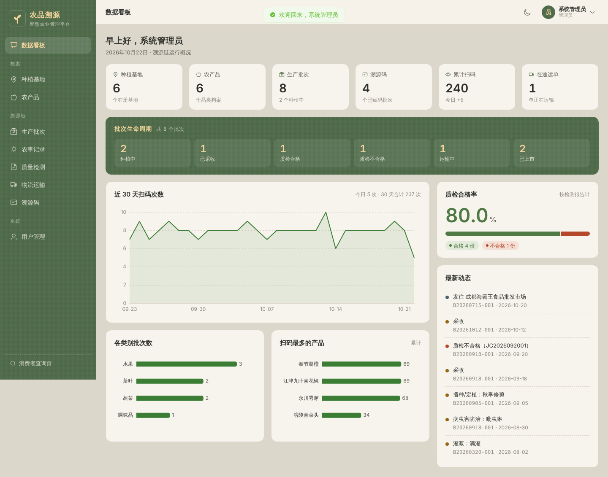
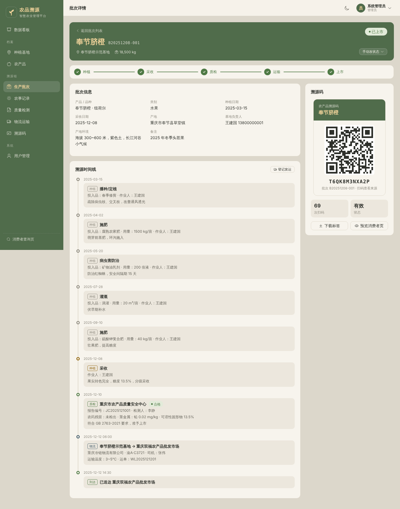
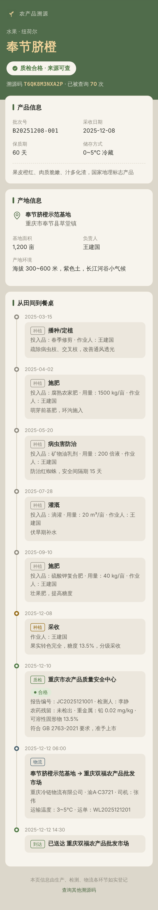
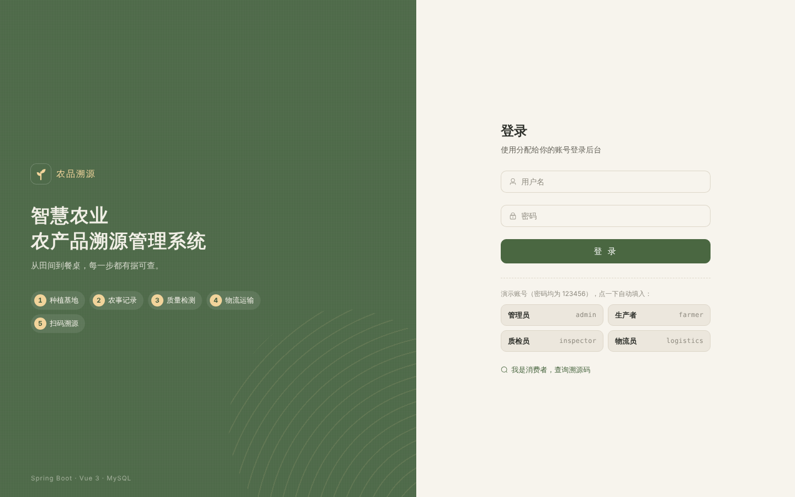
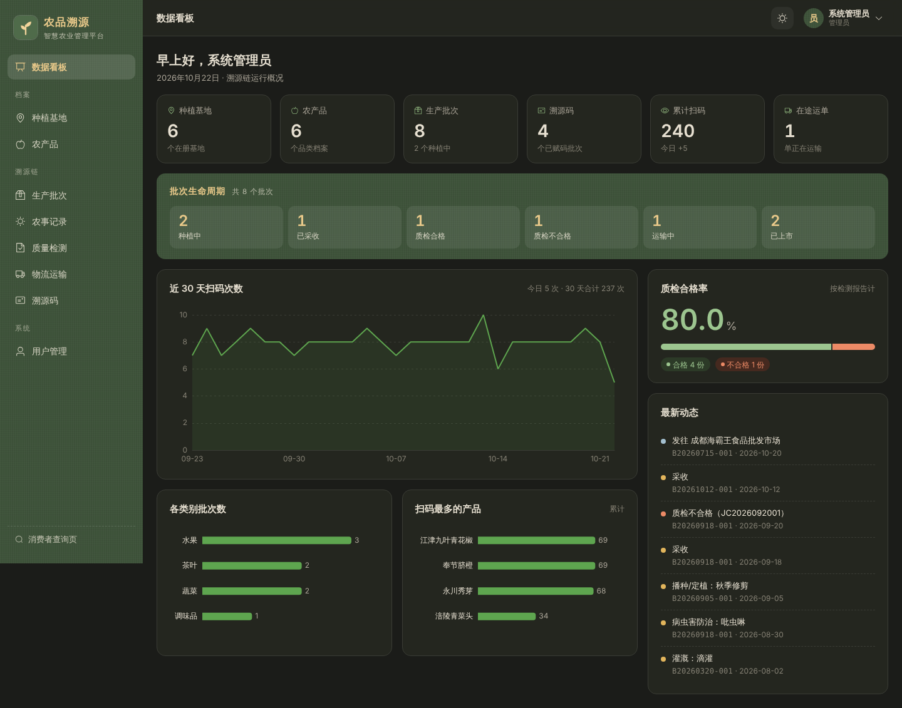

# 智慧农业农产品溯源管理系统

> Spring Boot + Vue3 + MySQL 全栈实战 · 重庆城市科技学院 · 软件工程专业

从田间到餐桌，每一步都有据可查：生产者登记种植过程，质检员出具检测报告，物流员记录运输，合格批次生成**一批一码**的溯源码；消费者扫码即可看到完整的来源时间线。

**部署请看 → [DEPLOY.md](./DEPLOY.md)**（Docker 一键部署 / 手动部署 / 本地开发，含验收清单和排错表）



## 功能

| 模块 | 说明 |
|---|---|
| 数据看板 | 基地/产品/批次/溯源码/扫码量等指标，批次生命周期分布，近 30 天扫码趋势，质检合格率，各类别批次数，扫码最多的产品，最新动态 |
| 种植基地 | 基地档案：编号、地址、面积、负责人、产地环境 |
| 农产品 | 品类档案：类别、品种、单位、保质期、储存方式 |
| 生产批次 | 溯源的基本单位；批次号自动生成；详情页展示流程进度、完整溯源时间线、溯源码标签 |
| 农事记录 | 播种 / 施肥 / 灌溉 / 病虫害防治 / 除草 / 采收；登记「采收」自动把批次推进到已采收 |
| 质量检测 | 农残、重金属等检测项与结论；合格→可发运可赋码，不合格→禁止流通 |
| 物流运输 | 运单、承运单位、车辆、温度；确认到达后批次自动变为「已上市」 |
| 溯源码 | 一批一码，生成二维码标签（可下载 PNG 打印），统计扫码次数，可作废 |
| 消费者查询 | 免登录的手机端页面 `/trace/<溯源码>`，展示产品、产地、种植→质检→物流时间线 |
| 用户管理 | 四种角色：管理员 / 生产者 / 质检员 / 物流员，按角色控制菜单和接口权限 |
| 个人中心 | 修改资料、修改密码；全站支持日间 / 夜间主题 |

### 批次状态流转

```
种植中 ──采收──▶ 已采收 ──质检合格──▶ 质检合格 ──发运──▶ 运输中 ──到达──▶ 已上市
                        └─质检不合格─▶ 质检不合格（不能发运、不能赋码）
```

状态由业务操作自动推进（管理员可在批次详情里手动纠正）。进入质检后农事记录锁定，保证溯源数据不被事后篡改。

## 截图

| 批次详情 + 溯源码 | 消费者扫码页（手机） |
|---|---|
|  |  |

| 登录 | 夜间模式 |
|---|---|
|  |  |

## 技术栈

- **后端**：Spring Boot 3.3、MyBatis-Plus 3.5（分页插件）、MySQL 8、JJWT（JWT 登录）、BCrypt 密码加密、Bean Validation、Lombok
- **前端**：Vue 3（`<script setup>`）、Vite 5、Vue Router 4、Pinia、Element Plus、ECharts 5、Axios、qrcode、dayjs
- **部署**：Docker Compose（MySQL + 后端 + Nginx 前端），或 jar + Nginx 手动部署

## 目录结构

```
backend/                       Spring Boot 后端
  src/main/java/com/agritrace/
    common/                    统一返回体 Result、分页、业务异常、全局异常处理、常量
    config/                    MVC 拦截器与跨域、MyBatis-Plus 分页、Jackson 时间格式
    security/                  JWT 工具、登录拦截器、@RequireRole 角色注解、当前用户上下文
    entity/  mapper/           实体与 Mapper（MyBatis-Plus）
    service/                   业务逻辑（状态流转规则都在这里）
    controller/                REST 接口
    dto/                       请求/响应对象
  src/main/resources/application.yml
frontend/                      Vue3 前端
  src/api/                     Axios 封装与接口定义
  src/layout/                  后台布局（侧栏、顶栏）
  src/views/                   各页面（public/ 下是消费者查询页）
  src/components/              图表、时间线、溯源码标签、状态标签
  src/styles/theme.css         主题色板（日间/夜间）与 Element Plus 覆盖
sql/schema.sql  sql/data.sql   建表脚本与演示数据
deploy/                        手动部署用的 Nginx 配置和 systemd 服务
docker-compose.yml             一键部署
```

## 快速开始（本地）

```bash
mysql -uroot -p < sql/schema.sql && mysql -uroot -p < sql/data.sql
cd backend && DB_PASSWORD=你的密码 mvn spring-boot:run      # http://localhost:8080
cd frontend && npm install && npm run dev                    # http://localhost:5173
```

或者直接 `cp .env.example .env && docker compose up -d --build`，打开 http://localhost 。

### 演示账号（密码均为 `123456`）

| 账号 | 角色 | 能做什么 |
|---|---|---|
| `admin` | 管理员 | 全部功能，含用户管理、删除、作废溯源码、手动改批次状态 |
| `farmer` | 生产者 | 维护基地、产品、批次、农事记录，生成溯源码 |
| `inspector` | 质检员 | 录入 / 修改质检记录 |
| `logistics` | 物流员 | 登记发运、确认到达 |

演示溯源码：`T6QK8M3NXA2P`、`T7LJ2C9TGW8H`（打开 `/trace` 页面输入，或直接访问 `/trace/T6QK8M3NXA2P`）。

## 接口一览

所有接口前缀 `/api`，返回 `{ code, msg, data }`，`code=200` 为成功。除标注「公开」外都需要请求头 `Authorization: Bearer <token>`。

| 方法 | 路径 | 说明 |
|---|---|---|
| POST | `/auth/login` | 登录（公开），返回 token 和用户信息 |
| GET / PUT | `/auth/me`、`/auth/profile`、`/auth/password` | 当前用户、改资料、改密码 |
| GET/POST/PUT/DELETE | `/users`、`/users/{id}`、`/users/{id}/reset-password` | 用户管理（管理员） |
| GET/POST/PUT/DELETE | `/bases`、`/bases/options` | 种植基地 |
| GET/POST/PUT/DELETE | `/products`、`/products/options` | 农产品 |
| GET/POST/PUT/DELETE | `/batches`、`/batches/{id}`（详情含全链路）、`/batches/options?status=A,B`、`/batches/{id}/status` | 生产批次 |
| GET/POST/PUT/DELETE | `/farming-records` | 农事记录 |
| GET/POST/PUT/DELETE | `/inspections` | 质检记录 |
| GET/POST/PUT/DELETE | `/logistics`、`/logistics/{id}/arrive` | 物流记录、确认到达 |
| GET/POST/PUT | `/trace-codes`、`/trace-codes/batch/{batchId}`、`/trace-codes/{id}/status` | 溯源码列表、生成、作废/启用 |
| GET | `/dashboard/overview` | 看板统计 |
| GET | `/public/trace/{code}` | 消费者扫码查询（公开，会记录一次扫码） |
| GET | `/health` | 健康检查（公开） |

列表接口统一支持 `page`、`size` 分页参数以及各自的筛选参数（`keyword`、`status` 等）。

## 数据表

`sys_user` 用户 · `farm_base` 种植基地 · `product` 农产品 · `batch` 生产批次 · `farming_record` 农事记录 · `inspection` 质检记录 · `logistics` 物流记录 · `trace_code` 溯源码 · `trace_scan_log` 扫码日志。字段说明见 `sql/schema.sql` 中的注释。
